# Awesome API Authentication & Credential Management 🔐

**A curated index of top-tier Secrets Management SaaS platforms, Self-Hosted Vaults, Dynamic Credential Brokers, and Open-Source Security Engines.**

  
  
  
  
  
  
  

*Defend against secrets sprawl, govern non-human machine identities, automate OAuth & API tokens, and secure agentic AI workflows.* 🚀

**Last updated: November 2026**

---

## 📌 Table of Contents

- [🌐 Sector Overview & Market Dynamics](#-sector-overview--market-dynamics)
- [☁️ SaaS / Hosted Platforms](#️-saas--hosted-platforms)
- [💻 Open-Source GitHub Projects](#-open-source-github-projects)
- [🤝 How to Contribute](#-how-to-contribute)
- [💖 Support](#-support)
- [📈 Star History](#-star-history)
- [⚠️ Disclaimer](#️-disclaimer)

---

## 🌐 Sector Overview & Market Dynamics

The global **secrets management solutions market** was valued at **USD 2.43 billion in 2025** and is projected to reach **USD 7.86 billion by 2034** at a compound annual growth rate (**CAGR of 14.1%**). Driven by the exponential growth of microservices, cloud infrastructure, and autonomous agentic AI workloads, **API keys and machine tokens** represent the fastest-growing secret type expanding at **17.88% CAGR**.

The market structure is **moderately fragmented yet bifurcated**:
1. **Hyperscaler Baseline Services** (AWS Secrets Manager, Azure Key Vault, Google Secret Manager) dominate platform-native cloud storage and compute-adjacent encryption.
2. **Specialized Multi-Cloud & Enterprise PAM Platforms** (CyberArk, HashiCorp Vault / IBM, Doppler, 1Password) capture complex multi-environment sprawl, just-in-time dynamic secrets, and zero-trust machine-to-machine identity governance.

---

## ☁️ SaaS / Hosted Platforms

| Platform | Company Size (Valuation / Revenue) | Pricing | Free Tier / Trial Limits | Key Focus & Capabilities |
| :--- | :--- | :--- | :--- | :--- |
| **Microsoft Azure Key Vault** | ~$3.1T Market Cap (Microsoft) | $0.03 per 10,000 operations (keys/secrets/cert operations) | 30-day trial with $200 free Azure credits; free storage (pay only per operation) | Native Azure secrets, keys, and HSM certificate storage. |
| **Google Secret Manager** | ~$2.1T Market Cap (Alphabet) | $0.06 per active secret version/mo + $0.03 per 10,000 operations | Free forever: 6 active secret versions and 10,000 access operations per month | Native GCP secret storage, replication, and audit logging. |
| **AWS Secrets Manager** | ~$2.0T Market Cap (Amazon) | $0.40 per secret per month + $0.05 per 10,000 API calls | 30-day free trial from 1st stored secret; new accounts get up to $200 credits | Managed secrets with native automatic rotation for RDS, Aurora, and Redshift. |
| **CyberArk (Privilege Cloud)** | ~$1.44B ARR / $18.5B Market Cap (Acq. pending PANW) | From ~$125/user/month (~$1,500/user/year list, typically 25-user minimum) | No public self-service free tier; guided 30-day PoC evaluation upon request | Enterprise privileged access management (PAM), dynamic credential brokerage, and compliance. |
| **Okta** | ~$2.6B ARR / ~$15B Market Cap | From $6/user/mo (Starter) to $17/user/mo (Essentials); APIAM add-on ~$2/user/mo (Enterprise custom) | Integrator Free Plan limited to 10 active users; 30-day enterprise trial | Workforce and customer identity governance with API Access Management and OAuth tokens. |
| **Auth0** (by Okta) | Part of Okta (~$2.6B ARR) / $6.5B Acq. Val | B2C from $35/mo (500 MAU); B2B from $150/mo (500 MAU) | Free forever: up to 25,000 MAUs, unlimited social connections, and 1 enterprise connection | Developer-first CIAM/B2B identity platform with token minting and API authorization. |
| **HashiCorp Vault (HCP Vault Dedicated)** | $350M+ ARR / $6.4B Acq. (by IBM) | HCP Vault Essentials from ~$1.58/cluster/hour (~$1,152/mo) + $72.92/client/mo; Standard from ~$1.85/hr | Self-hosted Community Edition is 100% free; HCP Dedicated provides $500 trial credits | Managed Vault clusters with dynamic secrets, PKI engine, and transit encryption. |
| **1Password** | $408M+ ARR / $6.8B Valuation | Business at $7.99/user/month; Starter Pack at $19.95/month (up to 5 users) | 14-day free trial on Business & Teams plans (no credit card required) | Credential management extending to developer CLI, SSH agent, and service accounts. |
| **Postman** | $313M+ ARR / $3.6B–$5.6B Valuation | Basic/Team from $19/user/month (billed annually); Solo paid plans from $14/mo | Free forever: 1 user (solo developer) with unlimited collection runs and mock calls | API collaboration platform managing environment secrets, tokens, and mock auth. |
| **Doppler** | ~$10M–$20M ARR / ~$80M Valuation | Developer tier free (up to 3 seats); Team tier at $8/user/month or $21/user/month | Free forever: up to 3 seats with unlimited projects, environments, and secrets sync | Developer-first secrets sync and orchestration across local envs, CI/CD, and AI agents. |

---

## 💻 Open-Source GitHub Projects

- **HashiCorp Vault** 
  - 📖 **Description**: The most mature open-source secrets engine (MPL 2.0 / BSL), free and self-hosted. Provides KV storage, dynamic secrets for databases and clouds, transit encryption-as-a-service, and PKI certificate authority.
  - 🛠️ **Tech Stack**: Go | 🚀 **Deploy**: Binary, Docker, Kubernetes

- **Infisical** 
  - 📖 **Description**: Modern end-to-end secrets management platform (MIT / Business Source) with an intuitive web dashboard, secret scanning, dynamic secrets, Kubernetes operator, SDKs, and AI agent credential security.
  - 🛠️ **Tech Stack**: Node.js, TypeScript, PostgreSQL | 🚀 **Deploy**: Self-hosted (Docker) or Infisical Cloud

- **SOPS (Secrets OPerationS)** 
  - 📖 **Description**: Simple, flexible editor for encrypted files (YAML, JSON, ENV, INI, binary) supporting AWS KMS, GCP KMS, Azure Key Vault, HashiCorp Vault, and age/PGP keys for GitOps workflows.
  - 🛠️ **Tech Stack**: Go | 🚀 **Deploy**: CLI tool, CI/CD integration

- **Teleport** 
  - 📖 **Description**: Identity-native infrastructure access management providing zero-trust credential issuance, short-lived certificates, and session recording for SSH, Kubernetes, databases, and internal web applications.
  - 🛠️ **Tech Stack**: Go | 🚀 **Deploy**: Self-hosted cluster, Teleport Cloud

- **Bitwarden Server** 
  - 📖 **Description**: Open-source backend infrastructure for Bitwarden Password Manager and Bitwarden Secrets Manager, offering programmatic secret retrieval, CLI access, and developer SDKs.
  - 🛠️ **Tech Stack**: C#, .NET, Docker | 🚀 **Deploy**: Self-hosted (Docker Compose)

- **Git-crypt** 
  - 📖 **Description**: Transparent encryption of sensitive files in Git repositories. Keeps repository contents readable while automatically encrypting selected files when committed and decrypting when checked out.
  - 🛠️ **Tech Stack**: C++ | 🚀 **Deploy**: CLI tool, Git filter

- **OpenBao** 
  - 📖 **Description**: Community-governed, truly open-source fork of HashiCorp Vault maintained under the OpenSSF (Linux Foundation) to ensure continuous open-source API-compatible secrets management under MPL-2.0.
  - 🛠️ **Tech Stack**: Go | 🚀 **Deploy**: Binary, Docker, Kubernetes

- **External Secrets Operator** 
  - 📖 **Description**: Kubernetes operator that synchronizes credentials from external APIs and vaults (AWS Secrets Manager, HashiCorp Vault, Azure Key Vault, GCP Secret Manager, Infisical) directly into Kubernetes native Secrets.
  - 🛠️ **Tech Stack**: Go | 🚀 **Deploy**: Kubernetes Operator (Helm)

- **Square Keywhiz** 
  - 📖 **Description**: Systems architecture designed by Square for distributing and managing secrets, certificates, and keys securely to servers and microservices with mutual TLS (mTLS).
  - 🛠️ **Tech Stack**: Java | 🚀 **Deploy**: Self-hosted service

- **Lyft Confidant** 
  - 📖 **Description**: Secrets management service developed by Lyft that uses AWS KMS and DynamoDB for end-to-end encrypted storage, user-friendly UI, and IAM-based authentication.
  - 🛠️ **Tech Stack**: Python, AngularJS, AWS KMS | 🚀 **Deploy**: Self-hosted AWS deployment

- **Pinterest Knox** 
  - 📖 **Description**: High-performance secret management service built by Pinterest for storing, rotating, and distributing cryptographic keys and access tokens with strict audit trails.
  - 🛠️ **Tech Stack**: Go | 🚀 **Deploy**: Self-hosted service

- **AthenZ** 
  - 📖 **Description**: Fine-grained role-based access control (RBAC) and dynamic X.509 certificate provisioning system for machine identities, service-to-service authentication, and short-lived tokens in dynamic cloud environments.
  - 🛠️ **Tech Stack**: Java, Go | 🚀 **Deploy**: Self-hosted (Docker, Kubernetes)

- **CyberArk Conjur** 
  - 📖 **Description**: Security platform specifically designed for DevOps and cloud-native application environments to authenticate, authorize, and control machine identities and secrets.
  - 🛠️ **Tech Stack**: Ruby, Go | 🚀 **Deploy**: Docker, Kubernetes

- **Keygate** 
  - 📖 **Description**: Open-source license and API credential enforcement platform supporting subscriptions, floating licenses, offline tokens, atomic quota enforcement, and Stripe integration.
  - 🛠️ **Tech Stack**: Go, SQLite/PostgreSQL | 🚀 **Deploy**: Single binary, Docker

---

## 🤝 How to Contribute

Contributions are welcome! Help maintain this list as the premier open-source guide for API authentication and credential management:

1. 🍴 Fork this repository.
2. 🌿 Create a feature branch: `git checkout -b add-new-secrets-tool`.
3. 📝 Add or update entries in `README.md` adhering to factual metrics, pricing, and category distinctions.
4. 🚀 Push changes and open a Pull Request with a clear description of the project.

⭐ **Star this repository** if you find it helpful for your infrastructure or security architecture!

---

## 💖 Support

If you find this repository valuable for your engineering projects, platform design, or security audits, please consider supporting the project:

- ⭐ **Star this repo** on GitHub to amplify visibility.
- 🍴 **Fork and contribute** new tools, benchmarks, and updates.
- 📢 **Share with colleagues** on Twitter, LinkedIn, and developer communities.
- ☕ **Buy me a coffee**: Support ongoing curation and maintenance via the [GitHub Sponsors Dashboard](https://github.com/sponsors/ishandutta2007).

---

## 📈 Star History

---

## ⚠️ Disclaimer

- 🛡️ This is a **community-curated directory** intended for informational and architectural guidance—not an endorsement.
- 🔐 Credential management platforms handling secrets and API keys must comply with relevant data protection regulations (GDPR, SOC 2, HIPAA, ISO 27001) and enforce rigorous encryption, role-based access control, and auditing. **A secrets vault is only as secure as its configuration.**
- 🧩 **Managed secrets service vs. Self-hosted vault vs. Identity provider vs. Licensing engine**:
  - **AWS Secrets Manager, Azure Key Vault, Google Secret Manager**: Managed hyperscaler services with zero infrastructure overhead.
  - **HashiCorp Vault, OpenBao, Infisical**: Self-hosted multi-cloud engines offering granular control, dynamic credentials, and zero vendor lock-in.
  - **Okta, Auth0**: Identity platforms specializing in authentication protocols (OAuth 2.0, OIDC, SAML, JWT) rather than raw arbitrary secret storage.
  - **Keygate**: Specialized software licensing platform enforcing activation quotas, not general-purpose API key vaults.
- 🏢 **Corporate Transitions**: Note that CyberArk is under acquisition by Palo Alto Networks, and HashiCorp is under IBM; verify organizational roadmap alignment when designing long-term enterprise systems.

---

**Built with precision for security engineers, DevOps professionals, and platform teams worldwide.** 🌍

